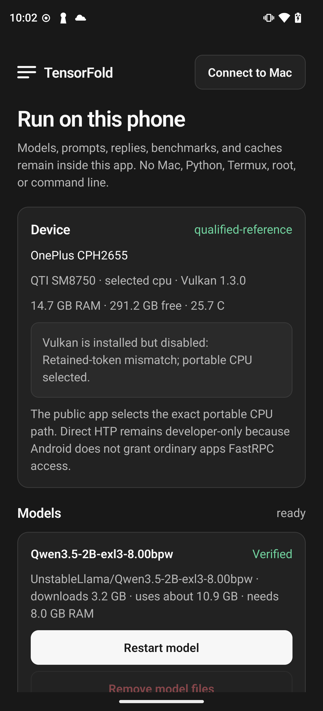
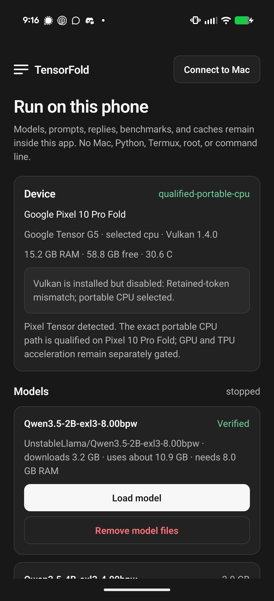

# TensorFold for Android

TensorFold Mobile 1.1.0 adds an ordinary, rootless Android runtime to the existing private Mac companion app. Android opens **Run on this phone** first; **Connect to Mac** remains an optional screen for the existing companion workflow. Phone-local operation does not require Python, Termux, ADB, root, a shell, or a separately started HTTP server.

## Runtime strategy

The distributable APK and the privileged custom-kernel HTP prototype remain separate:

- The public APK packages Qualcomm QAIRT 2.50 runtime components and app-UID QNN HTP capability gates alongside the vendor-independent GGML CPU/Vulkan engines. On stock Phone B, the shell validator and ordinary TensorFold app UID executed the calculator on Hexagon v79 without root. Synthetic, checked-in 4x3 and complete 128x128 EXL3 fixture graphs pass; the app now also prepares a 128x128 layer-0 block directly from its pinned app-private 2B checkpoint and executes it through QNN in process, passing in 1.85 ms with 0.0011 maximum error. This proves rootless QNN graph execution over live checkpoint-derived data, not full model inference.
- Model execution still selects CPU: on Snapdragon SM8750 that path reproduced the retained 4B output `248068,198,90700,8340,25,271,16,13` exactly.
- Vulkan is a quarantined candidate. It initialized on Adreno 830 and decoded quickly, but the same frozen 4B prompt produced different tokens beginning `213390,3319,...`.
- The faster custom EXL3 HTP prototype remains a privileged developer path because an ordinary app UID cannot write directly to `/dev/fastrpc-cdsp`. The new QNN route must express and verify TensorFold projections through supported QNN graphs instead of relabelling the rooted custom kernel.
- Snapdragon SM8750, Snapdragon SM8250 and Google Tensor G5 are qualified on their exact unprivileged CPU paths. Acceleration remains separately gated per backend and operation.
- Google's dedicated Tensor TPU SDK remains a later adapter. The official SDK is currently distributed through its beta program and uses compiled LiteRT artifacts rather than TensorFold EXL3 checkpoints. The app makes no GPU or TPU claim from CPU results.

NNAPI is not a fallback: Android deprecated it in Android 15.

## Requirements

- Android 13/API 33 or newer
- `arm64-v8a`
- Vulkan 1.1 is detected and reported, but remains disabled until it passes the retained token gate
- Enough system memory and private app storage for the selected model

The app checks the SoC, ABI, Vulkan version, total and available RAM, free app storage, battery temperature, packaged runtime files, model files, and decoded-cache allowance before enabling a load.

### 32-bit and low-memory devices

The discovered TCL Smart TV Pro (`MT9689`, Android 14/API 34) is intentionally
excluded from the local-inference APK. It exposes only `armeabi-v7a`, has
2.45 GB total RAM (about 0.70 GB available), and 17.4 GB free storage. Even the
2B catalog entry requires an arm64 process, an 8 GiB RAM gate, and about
11.68 GB of model/cache storage. A 32-bit process also cannot address the
required model and runtime working set. Building an installable no-op engine
would misrepresent support; a separate remote-only TV companion is possible,
but phone-local TensorFold is not.

## Pinned model catalog

The APK accepts only catalog entries with fixed repository IDs, artifact byte counts, and SHA-256 values. It does not accept arbitrary repository names, paths, native code, or model configuration.

| Model | Network download | Decoded cache | Approximate private storage | Minimum RAM gate |
| --- | ---: | ---: | ---: | ---: |
| Qwen3.5-2B EXL3 8.00 bpw | 3.45 GB | 8.23 GB | 11.68 GB | 8 GiB |
| Qwen3.5-4B EXL3 4.00 bpw | 4.23 GB | 21.39 GB | 25.62 GB | 10 GiB |
| Qwen3.5-35B-A3B EXL3 2.54 bpw | 13.05 GB | none | 13.05 GB | 14 GiB, Snapdragon only |
| Qwen3.5-35B-A3B EXL3 4.00 bpw | 19.40 GB | none | 19.40 GB | 14 GiB, Snapdragon only |

Each download is HTTPS-only, bounded to approved Hugging Face delivery hosts, resumable into a `.part` file, size checked, SHA-256 checked, fsynced, and atomically renamed. Cancellation retains the partial file for a later resume. A 512 MiB safety reserve is kept beyond model and decoded-cache estimates. **Remove model files** deletes only the selected app-owned model and cache.

First load constructs a decoded cache for the dense 2B/4B profiles and can take substantially longer than later starts. The experimental 2.54-bpw 35B-A3B profile never builds a decoded full-model cache: its 12.99 GB of weight shards stay packed (the catalog lists a 13.05 GB download allowance), selected routed experts enter a bounded LRU, and all other EXL3 projections execute from packed bytes. Every cache and pager entry is content-bound to the admitted checkpoint. A model is never marked verified from file presence or repository naming alone. The 4.00-bpw 35B-A3B profile is the same packed MoE path at a higher bit-width: its 19.33 GB of weight shards stay packed across three safetensors shards, selected routed experts enter the same bounded LRU, and it likewise never builds a decoded full-model cache.

## Local chat and benchmark

After **Load model**, the app supports multi-turn chat with:

- 1–1,024 output tokens
- greedy temperature 0 for the currently qualified native engine
- no thinking mode
- per-request server timing and token rate
- a 43 C battery-temperature refusal before load, generation, and benchmark work

The quick benchmark performs one excluded warm-up followed by three measured 64-token greedy requests for code and chat. It reports each median, prefill time, request time, and temperature before and after. It is intentionally named `tensorfold-android-quick-v1`; it is not a community-v2 receipt. The standard community comparison remains five measured 256-token repetitions using the documented benchmark runner.

### Snapdragon reference evidence

Phone B (`SM8750`, Adreno 830, Android 16) installed version 1.1.0/code 2.
The host and installed base APK both hashed
`9b639364cef8764ba15288e84d9d935f2ce4a93a0726cbf8da5055e61690dc05`.
The launcher opened the on-phone screen, identified the device, displayed the
Vulkan refusal, admitted a hash-identical seeded 2B checkpoint, and reached
**ready** with the server running as the ordinary app UID `u0_a240`.
The qualification then removed only the app's verification marker and pressed
**Download and verify**. The native flow rechecked every complete artifact,
including the 3.44 GB weights, and restored **Verified** without trusting file
presence.

An authenticated 16-token request answered `LOCAL_OK` before model control
tokens; the UI client removes those control tokens. Server measurements were
3.674 s prefill, 0.875 s decode, 18.29 tok/s, and 4.562 s in all. An
unauthenticated request to the same forwarded loopback port returned HTTP 401.
Cancelling an in-flight 256-token generation stopped both native child
processes while the activity remained alive and usable. Force-stopping the APK
also removed its app-UID server process; no orphan remained.

The 2B quick workload contract, run through that app-owned authenticated server,
produced:

| 2B CPU quick workload | Median delivery | Median prefill | Median request |
| --- | ---: | ---: | ---: |
| Code | 16.10 tok/s | 0.661 s | 4.680 s |
| Chat | 15.69 tok/s | 0.635 s | 4.699 s |



Each row is three 64-token measurements after one excluded warm-up. These are
diagnostic CPU figures, not community-v2 and not a comparison with the
different-model HTP or llama.cpp runs.

### Snapdragon 865 compatibility evidence

A stock, unrooted Samsung Galaxy S20 Ultra 5G (`SM-G988U`) with Snapdragon
865 (`SM8250`), 10.4 GiB RAM and Android 12/API 31 installed version 1.1.0/code
2 after the source minimum SDK was lowered from 33 to 31. The installed APK
hashed `833ffbdb355537cc9582d52b38186566cc8cd6cbaa8adb59d052a9183849ded8`.
The app reported `qualcomm`, `compatible-unqualified`, CPU selected and Vulkan
1.1.0 quarantined. A rootless shell QNN calculator passed on Hexagon v66; the
current APK packages only the v79 app-UID probe, so Samsung app-UID HTP remains
unqualified. The app downloaded and verified the pinned 2B profile, built its
app-private decoded cache, reached `ready`, and returned `LOCAL_OK` through
private local chat at 2.6 tok/s.

The same `tensorfold-android-quick-v1` workload produced:

| Snapdragon 865 2B CPU quick workload | Median delivery | Median prefill |
| --- | ---: | ---: |
| Code | 2.61 tok/s | 1.97 s |
| Chat | 2.63 tok/s | 1.83 s |

Battery temperature moved from 24.3 C to 29.1 C. These are three measured
64-token runs after one excluded warm-up, not community-v2, HTP qualification
or a claim that the borderline 4B profile fits reliably on this 10.4 GiB device.

### 35B-A3B development status

The Snapdragon-only 35B-A3B catalog has two admitted profiles, both
experimental CPU qualification paths, not supported speed profiles or public
release artifacts. The 2.54-bpw profile is pinned to revision
`af18e8ad45f4d529925bab859d79e163dc5abe60` in
`turboderp/Qwen3.5-35B-A3B-exl3@2.54bpw`. The 4.00-bpw profile is pinned to
revision `8a68a1aca688b768853bad4d926c0136ff62286c` in
`turboderp/Qwen3.5-35B-A3B-exl3@4.00bpw` (19,329,446,010 weight bytes across
three shards, 4-bit projections and a 6-bit head). On Phone B, the app-owned
worker executes either packed checkpoint with no decoded full-model cache.
TensorFold matches ExLlamaV3 for the first eight generated tokens of `hi`.
Seven of eight ordered top-five lists match exactly; at the final observed step
the same five IDs appear, with reference-tied IDs `13` and `440` reversed at
ranks four and five. The 2.54-bpw stream, with the input ID first, is
`5834,11,353,1144,310,1791,264,3779,364`; the 4.00-bpw stream is
`5834,11,585,1318,310,1791,264,3779,364`. A fixed regression test covers the
routing-normalization defect found during that comparison.

Output-tile parallelism across 16 CPU workers reduced the one-token elapsed time
from 47.558 s to 13.872 s without changing the token or ordered top five. That
is still far below the release performance gate. The 256-token parity suite,
quality fixtures, thermal/lifecycle run and standard benchmark remain pending.
The private qualification APK containing this path hashes
`bfb4a34e11047e6c525e4848a67421451412cabf63a271504a8fc2e8820799b2`;
it is not a public release artifact.

The privileged HTP engineering lane uses the same 4.00-bpw checkpoint now
admitted to the catalog. Its CPU/HTP eight-token stream is
`5834,11,585,1318,310,1791,264,3779,364`, not the 2.54-bpw stream above.
Eight-token CPU and initial HTP end-to-end rates were 0.068943 and 0.343639
tok/s. A warm 64-token HTP run with only the head cached as decoded FP16 reached
0.753628 decode tok/s and 0.753648 end-to-end tok/s, 2,675,068 KiB peak RSS,
and battery temperature 31.2 C to 31.7 C.

Those are rooted engineering measurements, not ordinary app-UID HTP access,
full NPU-only execution, general model quality, a production release, or
publication-grade foreground-app/community-v2 results. The short CPU/HTP
comparison does not establish 64- or 256-token reference parity. The generic
low-bit HTP attempt on 2.54 bpw was slower than CPU; it is not hidden by the
4.00-bpw result. See [packed-direct MoE evidence](qualcomm-moe.md) for the
retained records and outstanding gates.

### Pixel Tensor reference evidence

The second physical qualification used a Google Pixel 10 Pro Fold with Google
Tensor G5, 15.2 GiB RAM, Android 17/API 37, and a PowerVR D-Series
DXT-48-1536 MC1 GPU. The app detected Vulkan 1.4.0 but retained the same
correctness gate: Vulkan remained disabled and the exact CPU backend was
selected. The final qualification APK hashes
`9b639364cef8764ba15288e84d9d935f2ce4a93a0726cbf8da5055e61690dc05`.

The ordinary app UID admitted the hash-pinned 2B checkpoint, constructed its
5,486,149,632-byte decoded cache in private storage, and reached **ready**.
Cold preparation moved battery temperature from 29.2 C to 30.4 C; a separate
direct preparation check moved it from 27.5 C to 28.1 C. A warm restart reused
all 150 projections with zero cache misses. A 16-token private-chat request
returned `LOCALOK` at a server-reported 2.1 tok/s. Force-stopping the APK
removed both the app-owned HTTP server and its inference worker.

The release package is built with flexible page-size support. Every merged
arm64 ELF load segment passed the 16 KiB alignment check required by current
Pixel devices. The exact CPU path is therefore labelled
`qualified-portable-cpu`; that label does not qualify the Pixel GPU or TPU.



## Process and network boundaries

- Model artifacts, decoded caches, logs, and verification markers stay below the app's private `filesDir`.
- The native server binds only `127.0.0.1:8082`.
- Android loopback is shared by applications, so binding to loopback alone is insufficient. Every app-owned server start receives a fresh random 256-bit bearer token. All routes, including health and metrics, reject requests without that token. The token is retained only inside the app process and is never returned to JavaScript or written to disk.
- PwnHarness receives the current endpoint and bearer only through an exported read-only `ContentProvider` guarded by the explicit `LOCAL_INFERENCE` Android runtime permission. The provider returns no row unless the app-owned server is ready, and the grant does not weaken PwnHarness scope, approval, evidence, or STOP enforcement.
- The app accepts readiness only from a server that proves authenticated, app-owned parent-death mode and the selected backend. A different process already using the port cannot be mistaken for TensorFold.
- The server and worker inherit parent-death signals. Force-stopping or killing the app cannot leave its owned model processes running.
- Cleartext networking is denied globally except for `localhost` and `127.0.0.1`. Remote companion traffic keeps its existing certificate-pinned HTTPS transport.
- Models cannot start above the thermal threshold. Runtime logs rotate at 2 MiB and do not store prompt text or replies.
- No broad storage, overlay, microphone, biometric, Accessibility, shell, or root permission is requested.

## Build

The reproducible Windows build entry point is:

```powershell
powershell -ExecutionPolicy Bypass -File tools/build_tensorfold_android_app.ps1 -Configuration debug
```

It pins Vulkan-Headers `vulkan-sdk-1.4.335.0` at commit `2fa203425eb4af9dfc6b03f97ef72b0b5bcb8350`, builds the Android Vulkan and CPU libraries, builds the dense 2B/4B engines, the paged 35B-A3B engine and the authenticated control plane, stages only the vendor-independent runtime, regenerates Android with Expo CNG, runs the local-runtime unit tests, and builds the APK.

For a release artifact:

```powershell
powershell -ExecutionPolicy Bypass -File tools/build_tensorfold_android_app.ps1 -Configuration release
```

`assembleRelease` in a generated development tree uses the Android debug key. That artifact is suitable for private qualification only. A public Play or signed direct release must provide the project's production keystore through a private build environment; signing material must never be committed.

The generated native projects and runtime `.so` files stay ignored. Source-of-truth files are the Expo config, config plugin, local Expo module, Zig backend selection, and build script.

## Pixel acceleration gate

The portable CPU implementation is physically qualified on Pixel 10 Pro Fold
through the same model catalog, authenticated loopback server, lifecycle
manager, and UI used on Snapdragon. The qualification recorded:

1. Tensor G5, PowerVR GPU, Vulkan 1.4.0, 15.2 GiB RAM, and API 37.
2. The packaged runtime and final APK hashes.
3. A hash-identical verified 2B checkpoint.
4. Cold private-cache construction and a warm all-hit restart.
5. A generated local chat reply.
6. Battery temperature before and after cache and inference work.
7. App-owned stop and force-stop behavior.
8. 16 KiB ELF load-segment compatibility.

GPU and TPU acceleration remain separate correctness tasks. A TPU claim
requires Google Tensor SDK access, a supported converted artifact, and
separate output-quality and performance evidence. Vulkan results must never be
labelled TPU results, and no accelerated backend may replace CPU until it
passes the retained-token gate.
